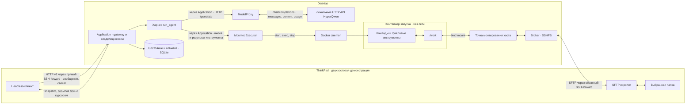

# ЧП2 · результаты проверки

[Вопросы преподавателя, общий блок и задание А](https://github.com/deeppavlov/agentic-course-itmo/blob/818740966b0d5b08fc9e46c3f6e449c824367ba9/projects/checkpoint-2-questions.md)

Доступ к DeepSeek пока не получен. Для предварительной проверки харнеса и инструментов полный БАФ запущен с локальной Qwen3.8-27B: она сама генерировала действия. Проверка целевой пары с DeepSeek ещё предстоит.

В smoke-БАФ v2 в CI действия задаёт тестовый скрипт. Харнес исполняет их, а чекер проверяет результат. По заданию курса источником действий должна быть разрешённая модель или запись её реальных ответов. [Задание А](https://github.com/deeppavlov/agentic-course-itmo/blob/818740966b0d5b08fc9e46c3f6e449c824367ba9/projects/A-agent-runtime.md) · [Правила выбора модели](https://github.com/deeppavlov/agentic-course-itmo/blob/818740966b0d5b08fc9e46c3f6e449c824367ba9/projects/README.md#0-1-модели)

## Как устроен mounted v2

Схема совмещает два проверенных сценария. Между машинами проверяли файловый тракт с mock-моделью. В полном БАФ локальная модель работала на desktop, там же находился синтетический экспорт. Полноценный графический клиент остаётся открытой частью задания. [Клиент v2](../track_a/client.py) · [Решение о границе монтирования](../track_a/docs/adr/0005-mount-boundary.md)

| Вопрос на защите | Что показать в реализации |
|---|---|
| Кто принимает сообщение и как клиент догоняет события? | Gateway проверяет bearer и владельца сессии. Клиент запрашивает события после сохранённого номера. При устаревшем курсоре сервер возвращает 410 и снимок. [Application](../track_a/application.py) · [Контракт v2](../track_a/protocol-v2.schema.json) |
| Где принимается решение о следующем действии? | Харнес собирает системную инструкцию, историю и запрос. Ответ модели завершает цикл или задаёт список вызовов. Результаты инструментов попадают в следующий запрос. Ограничены число шагов и размер сериализованного контекста. [Цикл](../track_a/run_loop.py) · [Валидатор](../track_a/contracts.py) |
| Где исполняется команда и у кого ключ модели? | ModelProxy обращается к провайдеру. Executor запускает инструмент через Docker в контейнере данного run. В контейнере UID 1000, read-only root, сняты capabilities, выключена сеть. [Proxy](../track_a/model_proxy.py) · [MountedExecutor](../track_a/mounted_executor.py) · [Флаги изоляции](../track_a/executor.py) |
| Что живёт дольше run? | Оператор поднимает экспорт и SSHFS. Executor на старте run проверяет mount внутри sandbox; остановка run удаляет его контейнер. После подтверждения остановки можно собрать снимок последнего run. В конце стенд снимает SSHFS и bind. [Жизненный цикл](../track_a/mounted_executor.py) · [Порядок очистки](../prototypes/mounted-runtime/README.md) |
| Почему нельзя просто повторить команду при потере ответа? | Запись могла уже произойти. Executor учитывает идентификатор операции, а харнес различает неизвестный исход и подтверждённую ошибку команды. Отмена проходит через Application к stop; терминальный result включает состояние очистки. [Обработка отказов](mounted-checkpoint2-failures.md) · [Тесты](../tests/test_mounted_failures.py) |
| Чем подтверждено качество? | В двух трассах одной задачи видны последовательность событий, время относительно старта, вызовы инструментов, коды возврата и usage там, где провайдер его вернул. Для отклонённого модельного шага исходная трасса не содержит полного ответа. [События B1.1 и вердикты](checkpoint2-evidence/b11-traces.json) |

Монтирование проверено между ThinkPad и desktop. Агент записал файл, оператор увидел его на ноутбуке и изменил, а агент прочитал изменение в той же сессии. На отдельном однохостовом стенде проверены отказы, изоляция и лимит общего RW-экспорта. [Двуххостовая трасса](two-host-checkpoint2.md) · [Сценарии отказов](mounted-checkpoint2-failures.md) · [Лимиты](mounted-limits-checkpoint2.md)

## Полный БАФ

На desktop локальный Qwen3.8-27B через ModelProxy выполнил 39 задач по три раза в профиле `mounted_v2_live`. Из 117 попыток 14 прошли, 103 завершились с fail, инфраструктурных ошибок — 0. Для каждой попытки подтверждена очистка. Ревизия, хеши и индивидуальные исходы приведены в [сводке серии](checkpoint2-evidence/baf.json).

| Причина отказа | Попыток |
|---|---:|
| Действие модели отклонено до чекера | 93 |
| Лимит контекста / шагов | 3 / 1 |
| Неверная медиана в B5.1 | 3 |
| Неверное решение о пересадке или время в B7.1 | 3 |

В B1.1 нужно определить порт сервиса и записать число в `answer.txt`. В первом повторе после просмотра каталога и неудачного запроса слушающих портов следующее действие было отклонено. Во втором модель прочитала конфиг и записала `8137`, чекер принял файл. Отдельный диагностический запуск с `enable_thinking=false` также прошёл до чекера. Его результат учитывается отдельно. Причина всех 93 отказов пока не установлена. [Результат диагностики](checkpoint2-evidence/b11-no-thinking.json) · [Чекер](../track_a/baf/B1-read/B1.1-service-port/check.py)

## Измерения A-3.6 и A-5.6

На одном синтетическом SSHFS-стенде выполнены 12 повторов. Для холодного старта каждый раз создавался новый sandbox при уже работающих Docker и SSHFS. Память измерялась по cgroup контейнера в простое. Медиана старта составила 254,32 мс, p95 — 376,12 мс. Для пустого exec получены 169,49 и 190,67 мс соответственно. Стенд очищен. [Методика, сырые замеры и сводка по всем операциям](checkpoint2-evidence/measurements.json)

## Проверки

Для кода ревизии `15dc1d3` в отдельной копии локально прошли модульные тесты, mock smoke-БАФ и штатный Docker-сценарий с перезапуском и очисткой. Запуск GitHub Actions на сдаваемом коммите требует отдельного подтверждения. [Конфигурация CI](../.github/workflows/cpu.yml)
