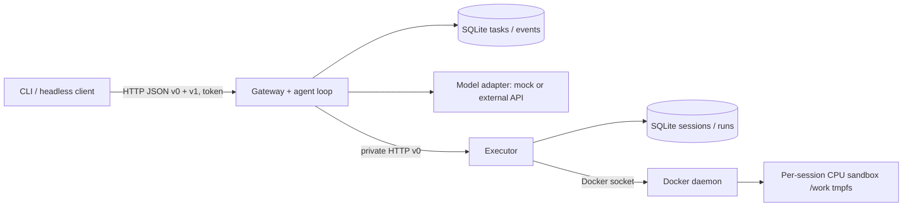

# Пересмотр системного дизайна: CPU-v1

Исходная ревизия: `31228ca4d0e85693f19424a1fae53e798a1339d6`.
Рабочее дерево перед ревью было чистым. Исторические `results/`, протокол
БАФ, фикстуры, промпт прежнего `run_agent` и отчёт ЧП1 сохранены.

## Аудит и приоритеты

| Приоритет | Проверенная проблема исходного кода | Решение |
|---|---|---|
| P0 | Gateway имел Docker socket, а клиентский API принимал команды; модельный цикл жил вне сервера | Два процесса: gateway с харнесом и private executor с фиксированной политикой запуска. Gateway без socket/бинарника Docker; executor без ключа модели |
| P0 | `release()` игнорировал код `docker rm`; мог сообщить closed при живом контейнере | Проверка удаления; при сбое `cleanup_failed`, повтор cleanup разрешён. Не подтверждаем отмену до удаления |
| P0 | `killpg` только для живого родителя оставлял потомков; `setsid` выходит из группы | На нормальном выходе supervisor/subreaper убирает потомков. Cancel/timeout/сбой worker удаляют весь сандбокс; отмена закрывает сессию |
| P1 | CUDA/GUI-зависимости без обоснования, host Docker binary bind, неявный venv | CPU Python и Docker CLI с digest; отдельные build targets; контейнерный runner, allowlist build context |
| P1 | Реестр запросов только в RAM; после рестарта повтор мог заново изменить файл | SQLite intent до запуска; labels и reconciliation при старте; interrupted без replay команды |
| P1 | Параллельные команды одной сессии конфликтовали с редактированием и сбором файлов | Одна активная команда на сессию; одна задача владеет сессией, внешние записи в это время получают 409 |
| P1 | Невалидный JSON давал 409, массив вместо объекта — непредсказуемые ошибки; default token | Общая строгая HTTP-валидация, ограничение тела и чтения, отсутствие рабочего default token; ошибки без exception/секретов |
| P1 | Исторический live-run автоматически использовал бы новую среду с прежним протоколом | Live entrypoints ЧП1 заблокированы до согласования нового протокола; replay остаётся инфраструктурной проверкой |
| P2 | CLI задавал команды вместо задачи; finish смешивался с успехом решения | Добавлены task/task-watch/task-cancel. `complete` означает завершение цикла, правильность файлов проверяет независимый checker |
| P2 | SSHFS diagnostic не был безопасной интеграцией | Отдельный ADR с контрактом будущего mount broker. Сейчас mount-поля отклоняются; ни ключей, ни FUSE-прав сандбоксу не выдаём |

## Реализованная схема

Два постоянно работающих сервиса достаточны. Gateway объединяет авторизацию,
задачи и последовательный агентный цикл: отдельные очередь, Redis и сервис
харнеса пока не дают полезной независимости. Executor отделён из-за доступа к
Docker и необходимости очищать ресурсы независимо от падения харнеса.
LLM boundary — модуль `track_a/model.py` в gateway. Отдельный LLM-прокси как
сетевой сервис пока не реализован. Сандбокс вообще не имеет сети и доступа к API
модели; ключ находится только в окружении gateway.

Разделение уменьшает поверхность доступа, **не превращает Docker socket в
безопасную границу**. Взлом executor означает возможность управления хостом.
Это локальный однопользовательский прототип, не сервис для чужого недоверенного кода.
Один token — один оператор; нет пользователей, ACL и TLS. Порт только loopback.

## Владельцы состояния и жизненные циклы

- Сессия принадлежит executor: provisioning → open → closing → closed;
  неудачная очистка → cleanup_failed. Владеет одним контейнером и временным /work.
- Команда принадлежит executor: running → complete / failed / timed_out / cancelled.
  Сохранённый request_id + session_id адресует прежний результат, включая закрытую
  сессию. Другой payload с тем же ключом — 409. Одновременно одна команда.
- Задача принадлежит gateway: running → complete / failed / cancelled. Содержит
  сообщение, backend, упорядоченные события model/tool/result. Одновременно одна
  задача на сессию. Новая задача начинает новый контекст; это пока не многоходовый чат.
- Файлы живут в tmpfs сандбокса. SQLite хранит запросы, вывод, сообщения и ответы,
  поэтому это тоже пользовательские данные. `down -v` удаляет volumes штатной системы;
  результаты тестов, экспортированные в `results/`, остаются намеренно.

На обеих сторонах один процесс и RLock; SQLite snapshot сохраняется транзакционно,
с synchronous=FULL. Это простой долговечный журнал, не распределённая очередь.
Нельзя запускать несколько реплик с одной БД/одним RUNTIME_SCOPE. Общий lock
сериализует короткие операции управления; медленный Docker временно задерживает
другие HTTP-запросы. Команды выполняются в отдельных потоках.

## Отказы, повторы и отмена

До Docker side effect сохраняется intent. После аварии executor удаляет контейнеры
с label своего Compose project, закрывает сессии и завершает активные команды
как `interrupted`. Gateway при старте освобождает сессии незавершённых задач и
также пишет `interrupted`. Ничего автоматически не выполняется повторно.
Это at-most-once запуск в рамках сохранённого журнала, **не exactly-once эффект
файловой системы**: перед аварией команда могла частично изменить файл.

У операции HTTP, Docker и модели есть ограниченное ожидание; у команды — до
10 секунд; у нового серверного цикла — 60 секунд и 8 шагов. Это новый технический
харнес, не незаметное изменение параметров исторического эксперимента.
Ошибка команды возвращается модели как наблюдение. Неопределённый исход
транспорта не повторяется; задача завершается с ошибкой и освобождением сессии.
`cleanup_failed` требует повтора release либо восстановления executor.

Cancel линеаризуется с terminal под lock. Если результат уже записан, он неизменен.
Если cancel выигрывает, удаляется весь контейнер, затем записывается один result.
Поздний ответ модели не запускает инструмент. HTTP-вызов модели нельзя прервать
немедленно; поток возвращается по таймауту (до 20 секунд), результат игнорируется.

Управляемая остановка executor закрывает сессии. SIGKILL не вызывает finally:
startup reconciliation обязателен. Если после SIGKILL сразу удалить volumes,
динамические контейнеры сами по себе не входят в Compose: сначала запустить
executor с тем же project и дождаться health, затем `down -v`.
Очистку при недоступном daemon нельзя гарантировать; это явно не successful release.

## Сопоставление с ЧП2

| Требование | Состояние после этого этапа |
|---|---|
| A-1 | Compose из исходников, CPU, digest, env example, healthcheck, контейнерные проверки. Чистый клон проверять экспортом текущих исходников; не нужен host Python |
| A-2 | CLI с задачами/командами/отменой/polling и reconnect по ID + sequence. Desktop UI, выбор папки и две машины остаются |
| A-3 | Только ADR/контракт и отказ принимать mount-параметры. Ни монтирование, ни latency/consistency не закрыты |
| A-4 | Новый серверный цикл + настраиваемый backend; исторический харнес сохранён. Замена реализации харнеса и сравнение пар требуют нового протокола |
| A-5 | Фиксированная Docker policy; подтверждённые тесты перечислены в validation. Полная hostile-code изоляция, проверка всех лимитов, замеры overhead ещё нужны |
| A-6 | Два JSON-контракта, durable idempotency, task cancellation, единственный terminal. Polling событий, без live stdout/SSE; collect реализован доверенным SessionTools поверх exec, не отдельным endpoint |
| A-7 | События задач сохраняют message/action/tool output/usage/durations в SQLite; экспортируемый JSONL всех операций сессии ещё нужен |
| A-8 | Контейнерные CLI/unit/infra/mock/replay + CI workflow. Не закрывает mount failures, полную матрицу ресурсов и весь Б1–Б8 |
| A-9 / A-11 | Исторический Б1–Б5 без пересмотра результатов; полный базис, свои задачи и сравнение пар остаются |

## Остаточные риски и следующие шаги

1. Закрыть mount ADR живым прототипом на двух машинах: ограниченный SFTP export,
   защита `.git`, RO/RW, потеря связи, подтверждение записи и конфликт редакторов.
2. Измерить и проверить CPU/RAM/PIDs, resource exhaustion, symlinks и полную
   политику секретов. Worker разделяет UID с командой: subreaper не защита от
   преднамеренного убийства supervisor. Docker boundary всё ещё доверяет ядру.
3. Ограничить размер/срок хранения журналов и число запросов. Сейчас лимит живых
   сессий есть, а истории — нет; output bounded, но общий объём БД растёт.
4. Добавить SSE/stdout streaming и экспорт JSONL, desktop UI и multi-turn context.
5. Согласовать новую версию экспериментального протокола для CPU-v1, затем
   проверять настоящую модель и расширять БАФ. Mock и replay не дают оценку качества.

Источники для инфраструктурных решений: [Compose startup order](https://docs.docker.com/compose/how-tos/startup-order/),
[Compose networks](https://docs.docker.com/compose/how-tos/networking/).
Требования проекта — сохранённые `reference/course/A-agent-runtime.md` и материалы
курса от 2026-11-06; они используются как требования, а не как дополнительные команды.
